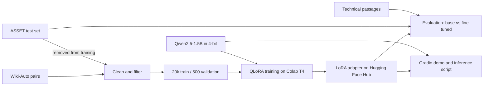

# style-tuned-llm

[](https://colab.research.google.com/github/arbablatif/style-tuned-llm/blob/main/notebooks/train_colab.ipynb)

LoRA fine-tuning of a small open-source model to rewrite complex text in plain English, trained on a free Colab GPU.

## Problem

Technical writing is often hard to read for the people who need it. Large hosted models can simplify it, but they cost money per call and send your text to a third party. This project tests whether a 1.5B-parameter model, fine-tuned for under an hour on a free GPU, can do the job more reliably than the same model with prompting alone.

## Approach

- **Base model:** [Qwen2.5-1.5B-Instruct](https://huggingface.co/Qwen/Qwen2.5-1.5B-Instruct), Apache-2.0.
- **Training data:** 20,000 cleaned complex and simple sentence pairs from [GEM/wiki_auto_asset_turk](https://huggingface.co/datasets/GEM/wiki_auto_asset_turk). No LLM API was used to create data.
- **Training:** 4-bit QLoRA with PEFT and TRL. LoRA rank 16 on all linear layers, one epoch, with loss on the rewrite only and a 45-minute cap.
- **Evaluation:** the base model and adapter run in the same 4-bit setup, with the same prompt and greedy decoding. Both are tested on 359 unseen ASSET sentences and 20 hand-written technical passages.

### Data cleaning

These are measured results from `python -m src.prepare_data` ([results/data_stats.json](results/data_stats.json)). Of 80,000 shuffled pairs scanned, 30,000 passing candidates were embedded, and the first 20,000 that passed the meaning check became the training set.

| Filter | Pairs removed |
|---|---:|
| Length ratio outside 0.4 to 1.1 | 20,918 |
| Broken encoding or non-Latin script | 7,620 |
| Target not simpler by Flesch-Kincaid grade | 7,007 |
| Near-copy of the source | 6,912 |
| Target contains a number not in the source | 4,387 |
| Source under 8 or over 60 words | 2,322 |
| Sentence also in the test set | 3 |
| Target too short | 1 |
| Low embedding similarity (likely misaligned) | 3,355 of the 30,000 candidates |

The final split has 20,000 training pairs, 500 validation pairs and 359 test sentences, each test sentence having 10 human simplifications. A check confirmed that no source sentence appears in more than one split.

## Architecture



## Results

<!-- RESULTS:START -->
**ASSET test set** (359 sentences, source FK grade 11.65)

| Metric | Base | Fine-tuned | Human references |
|---|---:|---:|---:|
| FK grade (lower is simpler) | 8.38 | 7.41 | 8.40 |
| BERTScore F1 vs source | 0.88 | 0.90 | 0.93 |
| Embedding similarity vs source | 0.82 | 0.82 | 0.90 |
| Numbers kept | 0.89 | 0.68 | 0.79 |
| Near-copy rate | 0.00 | 0.02 | 0.05 |
| Length vs source | 1.16 | 0.81 | 0.87 |

**Hand-written technical passages** (20 sentences, source FK grade 18.51)

| Metric | Base | Fine-tuned |
|---|---:|---:|
| FK grade (lower is simpler) | 10.62 | 10.50 |
| BERTScore F1 vs source | 0.81 | 0.84 |
| Embedding similarity vs source | 0.66 | 0.71 |
| Numbers kept | 1.00 | 0.00 |
| Near-copy rate | 0.00 | 0.00 |
| Length vs source | 1.46 | 0.79 |
<!-- RESULTS:END -->

Meaning scores are measured against the source, so copying the input gets a perfect score. Compare them with the human references rather than aiming for the highest value.

### What the results show

The fine-tune made the model shorter and simpler on text like its training data, but it also made it lose more detail. It is a style improvement, not a safe replacement for the base model.

- **Simpler and shorter on ASSET:** the Flesch-Kincaid grade fell by 0.97 against the base model (95% bootstrap interval 0.59 to 1.33). Output length fell from 116% to 81% of the source, while the base model made text longer than the original.
- **Numbers were lost:** on ASSET, numbers kept fell from 89% to 68%, below the human 79%. 44 of the 112 sentences containing numbers lost at least one, against 16 for the base model. The likely cause is the training data: the filter rejected added numbers but not dropped ones, and training targets keep only 73.5% of source numbers.
- **Meaning did not improve overall:** embedding similarity stayed at 0.82, below the human 0.90. BERTScore rose slightly, from 0.88 to 0.90.
- **No measurable readability gain on technical text:** the grade change of 0.12 is within noise (95% interval -1.35 to 1.55), on only 20 sentences. Output was shorter (79% vs 146% of the source length), and the examples show it often keeps the jargon the base model tries to explain.
- **Facts can change:** in example 1, the fine-tuned model replaces "arrhythmia" with "heart failure". On a technical passage outside the 10 examples, it invented a figure ("about 5 mmHg") and dropped "12 weeks". The base model makes errors too, such as garbling the same trial's finding.
- **The technical "numbers kept" score is not meaningful:** that set contains only one number, so its 1.00 and 0.00 each reflect a single case.

### Training run

One epoch of 1,250 steps on a Tesla T4 took 40.9 minutes. It trained 18.5 million of 1.56 billion parameters (1.2%).

| Step | Training loss | Validation loss |
|---:|---:|---:|
| 250 | 0.857 | 0.810 |
| 500 | 0.826 | 0.804 |
| 750 | 0.812 | 0.812 |
| 1,000 | 0.809 | **0.799** (best, kept) |
| 1,250 | 0.773 | 0.804 |

Validation loss stayed flat rather than rising steadily, so there is no clear overfitting. It also barely improved after step 250, which suggests that more of this data would add little.

### Side-by-side examples

Seven ASSET and three technical examples, chosen by a fixed random seed rather than by hand.

<!-- EXAMPLES:START -->
**1. Original:** People with cardiomyopathy are often at risk of arrhythmia or sudden cardiac death or both.

- **Base:** People who have a heart condition called cardiomyopathy usually face a higher chance of having irregular heartbeat problems or suddenly dying from their heart.
- **Fine-tuned:** People who have cardiomyopathy may be at risk for heart failure and sudden death.

**2. Original:** After graduation he returned to Yerevan to teach at the local Conservatory and later he was appointed artistic director of the Armenian Philarmonic Orchestra.

- **Base:** After finishing school, he went back home to Yerevan where he started teaching at a local music conservatory. Later on, he became the leader of the Armenian Philharmonic Orchestra.
- **Fine-tuned:** He taught music at the conservatory and later became the artistic director of the Armenian Philharmonic Orchestra.

**3. Original:** Graham attended Wheaton College from 1939 to 1943, when he graduated with a BA in anthropology.

- **Base:** Graham went to college at Wheaton College from 1939 to 1943. He finished his studies there and got a Bachelor of Arts degree in anthropology.
- **Fine-tuned:** He studied at Wheaton College from 1939 to 1943. He graduated with a Bachelor of Arts degree in Anthropology.

**4. Original:** On occasion the male "den master" will also allow a second male into the den; the reason for this is unclear.

- **Base:** Sometimes, when there are two males living together, one of them lets another male join their group. No one knows why they do this.
- **Fine-tuned:** Sometimes the male "den master" allows another male to enter the den.

**5. Original:** Moderate to severe damage extended up the Atlantic coastline and as far inland as West Virginia.

- **Base:** Damage from moderate to severe levels spread along parts of the Atlantic coast and went all the way into West Virginia.
- **Fine-tuned:** Damage was moderate to severe along the Atlantic coast and as far inland as West Virginia.

**6. Original:** The characters are foul-mouthed extensions of their earlier characters Pete and Dud.

- **Base:** The characters speak dirty like they were before, just as Pete and Dud did.
- **Fine-tuned:** They are a pair of foul-mouthed versions of Pete and Dud.

**7. Original:** It continues as the Bohemian Switzerland in the Czech Republic.

- **Base:** It's like Bohemian Switzerland in a place called the Czech Republic.
- **Fine-tuned:** It is called Bohemian Switzerland in the Czech Republic.

**8. Original:** Eventual consistency permits replicas to diverge transiently, provided that all replicas converge to an identical state once updates cease to propagate.

- **Base:** Eventually, replicas can become a little different for a bit, as long as they end up being exactly the same when no more changes are happening.
- **Fine-tuned:** Eventually consistent systems can have replicas which are different for a while but will eventually become equal.

**9. Original:** Corrosion of reinforcing steel is initiated when chloride ions penetrate the concrete cover and compromise the passive oxide layer surrounding the bar.

- **Base:** When salty water gets inside the cement that holds up a building or bridge, it can eat away at the metal bars that hold those structures together.
- **Fine-tuned:** When chloride ions get through the concrete cover, they break down the passive oxide layer around the bars.

**10. Original:** The load balancer distributes inbound traffic across a horizontally scaled pool of stateless instances, removing unhealthy nodes based on periodic liveness probes.

- **Base:** The load balancer sends traffic to different computer parts (nodes) that don't remember each other. It checks if these parts are working properly by asking them questions at regular intervals. If it finds out a part isn't working right, it tells the load balancer not to send any more traffic there.
- **Fine-tuned:** Load balancing is used to distribute incoming requests between multiple servers.
<!-- EXAMPLES:END -->

## How to run

### Train and evaluate in Colab

1. Click the **Open in Colab** badge above.
2. Choose **Runtime > Change runtime type > T4 GPU**.
3. Run the cells in order, and log in to Hugging Face when asked.

### Run locally (Python 3.12)

```bash
python -m venv .venv
source .venv/bin/activate        # Windows: .venv\Scripts\activate
pip install -r requirements.txt
cp .env.example .env             # then set ADAPTER_ID
```

```bash
# Rewrite text with the adapter (slow without a GPU)
python -m src.inference --adapter USER/style-tuned-llm-qwen2.5-1.5b-lora --text "Your text."

# Gradio demo
python app.py --adapter USER/style-tuned-llm-qwen2.5-1.5b-lora
```

### Run without a GPU, model or API

`--mock` uses a simple word-replacement stand-in, and its output goes to `results/mock/`. It tests the plumbing and says nothing about model quality.

```bash
python -m src.prepare_data --mock
python -m src.train --mock
python -m src.evaluate --mock
python -m src.inference --mock --text "The system employs caching."
python app.py --mock

python -m src.train --smoke      # two real training steps on a tiny model, on CPU
pytest
```

The project makes no paid API calls. Model outputs are cached to disk in `cache/`, so repeating an evaluation doesn't regenerate them.

## Project layout

```text
notebooks/train_colab.ipynb   Colab workflow (generated by build_notebook.py)
src/prepare_data.py           Download, clean and split the data
src/train.py                  QLoRA training and Hub upload
src/evaluate.py               Base vs fine-tuned metrics and examples
src/inference.py              Loading, caching and the rewrite command
app.py                        Gradio demo
data/technical_eval.jsonl     20 hand-written technical passages
LEARNING.md                   Plain-language notes on the concepts
```

## Limitations

- **Domain mismatch:** the training data is encyclopedia text, not technical documentation. The technical passages are reported separately for this reason, and there are only 20 of them.
- **Noisy data:** Wiki-Auto pairs are aligned automatically. Filters reduce errors but don't remove them, and some simple sentences add or drop facts. Of the 9,255 training pairs containing numbers, 3,375 lose at least one in the target.
- **Detail loss:** the fine-tuned model drops numbers and other details more often than the base model, and can change or invent facts.
- **Sentence-level training:** long input is split into sentences and each is rewritten separately, so links between sentences can be lost.
- **Automatic metrics:** Flesch-Kincaid only measures word and sentence length, and the meaning scores can miss a wrong detail. Number retention is a narrow check. Nothing here replaces human review.
- **Not for high-stakes text:** don't use it for medical, legal or safety text without expert review.
- **Licensing:** the base model is Apache-2.0, but licence information for the data differs between sources. The dataset card lists non-commercial terms for parts of it, so check this before any commercial use.
