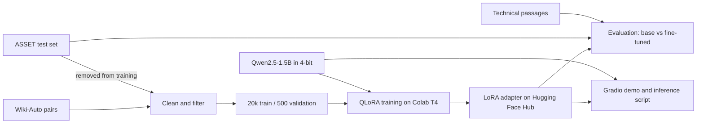

# style-tuned-llm

[](https://colab.research.google.com/github/arbablatif/style-tuned-llm/blob/main/notebooks/train_colab.ipynb)

LoRA fine-tuning of a small open-source model to rewrite complex text in plain English, trained on a free Colab GPU.

## Problem

Technical writing is often hard to read for the people who need it. Large hosted models can simplify it, but they cost money per call and send your text to a third party. This project tests whether a 1.5B-parameter model, fine-tuned for under an hour on a free GPU, can do the job more reliably than the same model with prompting alone.

## Approach

- **Base model:** [Qwen2.5-1.5B-Instruct](https://huggingface.co/Qwen/Qwen2.5-1.5B-Instruct), Apache-2.0.
- **Training data:** 20,000 cleaned complex and simple sentence pairs from [GEM/wiki_auto_asset_turk](https://huggingface.co/datasets/GEM/wiki_auto_asset_turk). No LLM API was used to create data.
- **Training:** 4-bit QLoRA with PEFT and TRL. LoRA rank 16 on all linear layers, one epoch, with loss on the rewrite only and a 45-minute cap.
- **Evaluation:** the base model and adapter run in the same 4-bit setup, with the same prompt and greedy decoding. Both are tested on 359 unseen ASSET sentences and 20 hand-written technical passages.

### Data cleaning

These are measured results from `python -m src.prepare_data` ([results/data_stats.json](results/data_stats.json)). Of 80,000 shuffled pairs scanned, 30,000 passing candidates were embedded, and the first 20,000 that passed the meaning check became the training set.

| Filter | Pairs removed |
|---|---:|
| Length ratio outside 0.4 to 1.1 | 20,918 |
| Broken encoding or non-Latin script | 7,620 |
| Target not simpler by Flesch-Kincaid grade | 7,007 |
| Near-copy of the source | 6,912 |
| Target contains a number not in the source | 4,387 |
| Source under 8 or over 60 words | 2,322 |
| Sentence also in the test set | 3 |
| Target too short | 1 |
| Low embedding similarity (likely misaligned) | 3,355 of the 30,000 candidates |

The final split has 20,000 training pairs, 500 validation pairs and 359 test sentences, each test sentence having 10 human simplifications. A check confirmed that no source sentence appears in more than one split.

## Architecture



## Results

<!-- RESULTS:START -->
*Pending: these are filled in automatically by the Colab run. No numbers have been measured yet.*
<!-- RESULTS:END -->

Meaning scores are measured against the source, so copying the input gets a perfect score. Compare them with the human references rather than aiming for the highest value.

### Side-by-side examples

Seven ASSET and three technical examples, chosen by a fixed random seed rather than by hand.

<!-- EXAMPLES:START -->
*Pending: these are filled in automatically by the Colab run.*
<!-- EXAMPLES:END -->

## How to run

### Train and evaluate in Colab

1. Click the **Open in Colab** badge above.
2. Choose **Runtime > Change runtime type > T4 GPU**.
3. Run the cells in order, and log in to Hugging Face when asked.

### Run locally (Python 3.12)

```bash
python -m venv .venv
source .venv/bin/activate        # Windows: .venv\Scripts\activate
pip install -r requirements.txt
cp .env.example .env             # then set ADAPTER_ID
```

```bash
# Rewrite text with the adapter (slow without a GPU)
python -m src.inference --adapter USER/style-tuned-llm-qwen2.5-1.5b-lora --text "Your text."

# Gradio demo
python app.py --adapter USER/style-tuned-llm-qwen2.5-1.5b-lora
```

### Run without a GPU, model or API

`--mock` uses a simple word-replacement stand-in, and its output goes to `results/mock/`. It tests the plumbing and says nothing about model quality.

```bash
python -m src.prepare_data --mock
python -m src.train --mock
python -m src.evaluate --mock
python -m src.inference --mock --text "The system employs caching."
python app.py --mock

python -m src.train --smoke      # two real training steps on a tiny model, on CPU
pytest
```

The project makes no paid API calls. Model outputs are cached to disk in `cache/`, so repeating an evaluation doesn't regenerate them.

## Project layout

```text
notebooks/train_colab.ipynb   Colab workflow (generated by build_notebook.py)
src/prepare_data.py           Download, clean and split the data
src/train.py                  QLoRA training and Hub upload
src/evaluate.py               Base vs fine-tuned metrics and examples
src/inference.py              Loading, caching and the rewrite command
app.py                        Gradio demo
data/technical_eval.jsonl     20 hand-written technical passages
LEARNING.md                   Plain-language notes on the concepts
```

## Limitations

- **Domain mismatch:** the training data is encyclopedia text, not technical documentation. The technical passages are reported separately for this reason, and there are only 20 of them.
- **Noisy data:** Wiki-Auto pairs are aligned automatically. Filters reduce errors but don't remove them, and some simple sentences add or drop facts.
- **Sentence-level training:** long input is split into sentences and each is rewritten separately, so links between sentences can be lost.
- **Automatic metrics:** Flesch-Kincaid only measures word and sentence length, and the meaning scores can miss a wrong detail. Number retention is a narrow check. Nothing here replaces human review.
- **Not for high-stakes text:** don't use it for medical, legal or safety text without expert review.
- **Licensing:** the base model is Apache-2.0, but licence information for the data differs between sources. The dataset card lists non-commercial terms for parts of it, so check this before any commercial use.
